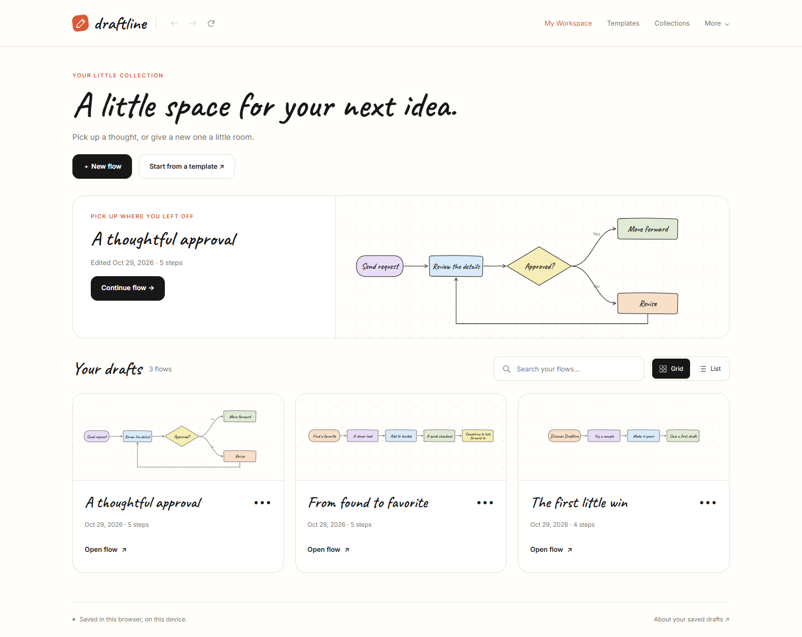
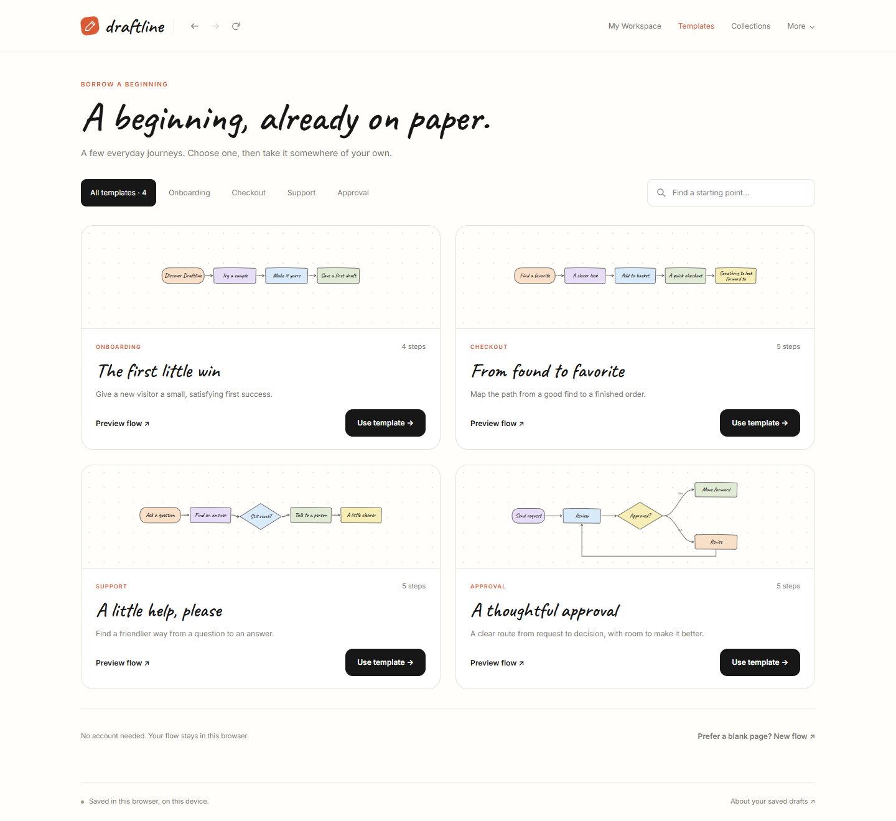
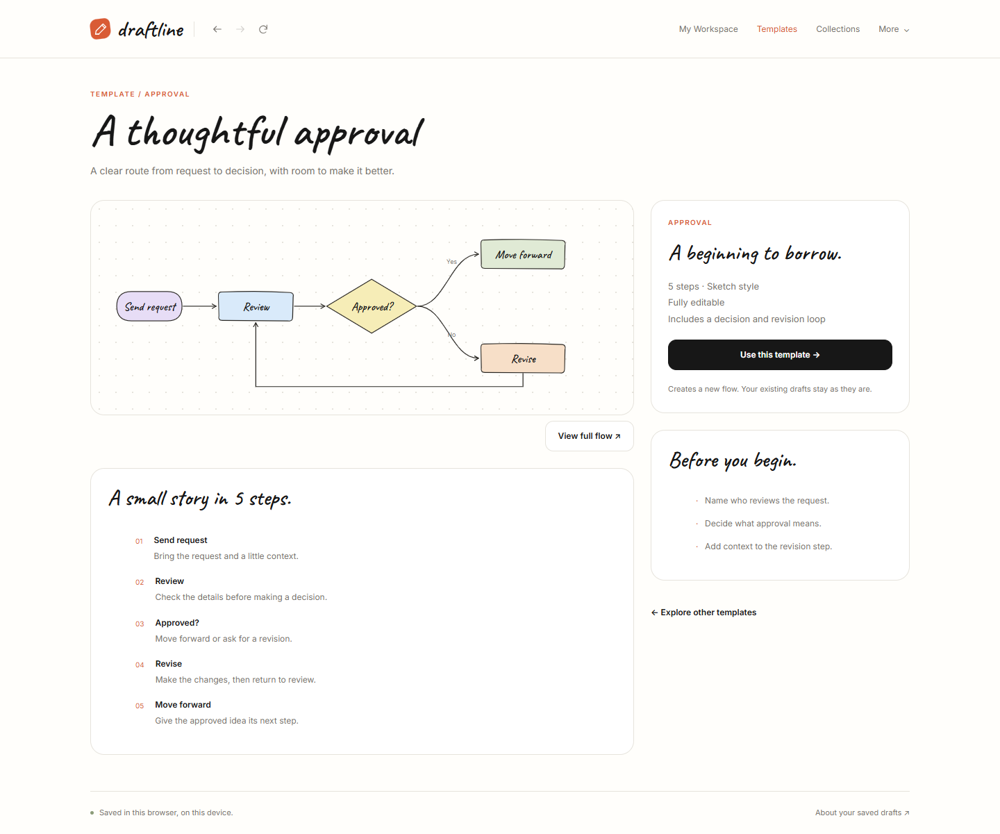
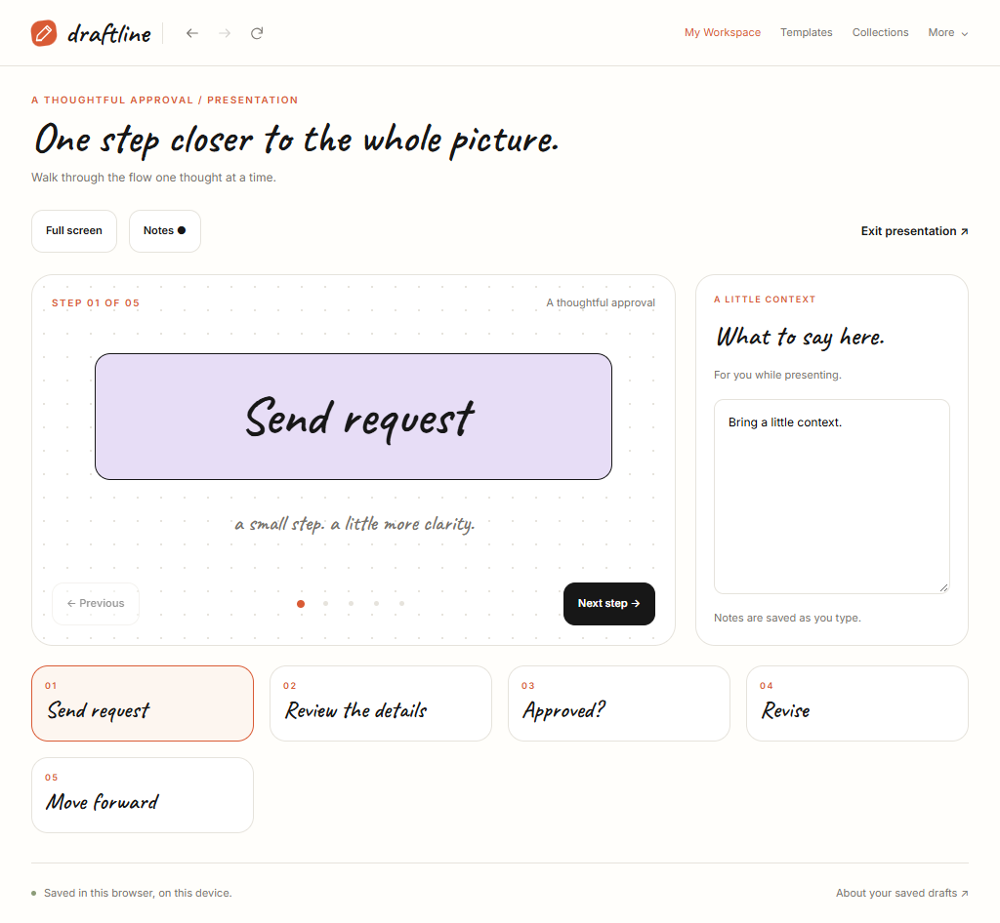
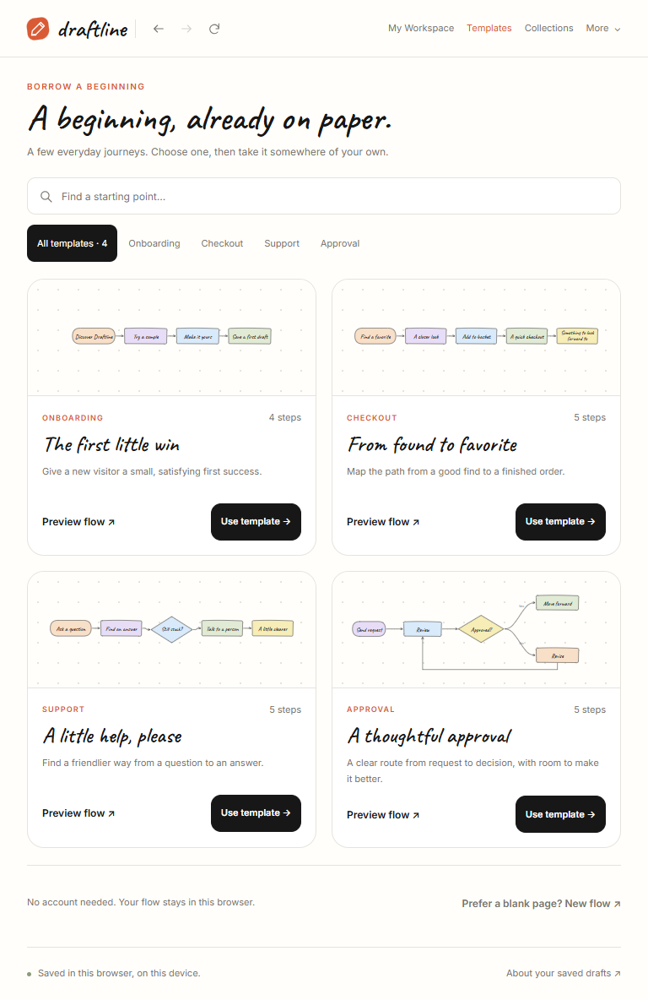
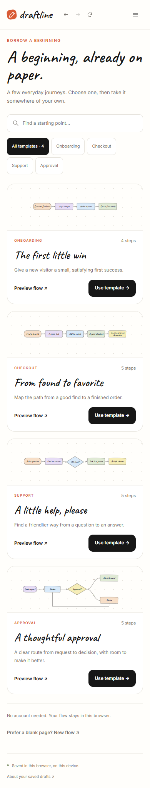
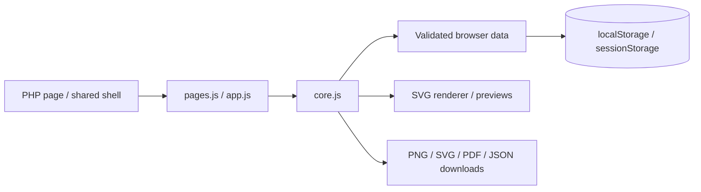

# Draftline

**Good ideas deserve a clearer path.**

Draftline คือเว็บแอปสำหรับเปลี่ยนไอเดียและขั้นตอนสั้น ๆ ให้เป็น **user flow ที่แก้ไข จัดเก็บ และนำเสนอได้** เหมาะกับนักพัฒนา Product Manager และทีมเล็กที่ต้องการอธิบายเส้นทางการใช้งานให้เห็นภาพ โดยเริ่มใช้งานได้ทันทีโดยไม่ต้องสมัครสมาชิก

หน้าตาได้แรงบันดาลใจจากกระดาษร่างไอเดีย: พื้นขาว จุดกริดบาง หัวข้อลายมือ สีพาสเทล สีส้มเฉพาะจุด และปุ่มหลักสีดำ ภายใต้หน้าตาเรียบง่ายมีทั้งพื้นที่จัดการงาน แม่แบบ ประวัติเวอร์ชัน โหมดนำเสนอ และการส่งออกไฟล์



> ภาพประกอบมาจากเว็บที่พัฒนาแล้ว ใช้ข้อมูลตัวอย่างใน browser context สำหรับทดสอบ แยกจากข้อมูลส่วนตัวของผู้ใช้

| มุมมอง | รายละเอียด |
| --- | --- |
| ประเภท | เว็บแอปจัดการ user flow แบบ local-first |
| สถานะ | ต้นแบบที่ใช้งานได้และผ่านการทดสอบในเครื่อง ยังไม่มี public demo หรือ production deployment ที่ระบุในโปรเจกต์ |
| ขอบเขต | Landing page + Flow Editor + หน้าจัดการงาน 10 หน้า |
| เทคโนโลยีหลัก | PHP, Vanilla JavaScript, CSS, SVG, Canvas 2D และ Web Storage |
| กระบวนการ | ออกแบบใน Pencil ผ่าน MCP → ตรวจดีไซน์ → พัฒนา → ทดสอบ |
| ข้อมูล | เก็บในเบราว์เซอร์ ไม่มีฐานข้อมูลฝั่งเซิร์ฟเวอร์ |
| หลักฐานทดสอบ | Functional 22/22 ชุด และ responsive 72/72 กรณี จากรอบตรวจ implementation |

## สารบัญ

- [แนวคิดและขอบเขตงาน](#overview)
- [ฟีเจอร์และหน้าที่พัฒนา](#features)
- [ตัวอย่างการใช้งาน](#walkthrough)
- [การออกแบบและ responsive](#design)
- [เทคโนโลยีและโครงสร้างระบบ](#architecture)
- [โจทย์ทางวิศวกรรมที่แก้ไข](#engineering)
- [ข้อมูลและความเข้ากันได้](#data)
- [วิธีรันในเครื่อง](#getting-started)
- [คำสั่งและการทดสอบ](#testing)
- [การเผยแพร่และข้อจำกัด](#limitations)
- [แก้ปัญหาที่พบบ่อย](#troubleshooting)
- [สิ่งที่ได้ฝึกและแนวทางต่อยอด](#lessons)
- [เอกสารและสิทธิ์การใช้งาน](#references)

<a id="overview"></a>
## แนวคิดและขอบเขตงาน

### ปัญหาที่ต้องการแก้

การเขียนขั้นตอนลงในโน้ตทำได้เร็ว แต่เมื่อมีเงื่อนไข ทางเลือก หรือการย้อนกลับ ข้อความอย่างเดียวอาจทำให้แต่ละคนเข้าใจไม่ตรงกัน ขณะเดียวกัน การเปิดเครื่องมือวาดแผนภาพขนาดใหญ่เพื่ออธิบาย flow สั้น ๆ อาจมีขั้นตอนมากกว่างานที่ต้องการทำ

Draftline จึงเริ่มจากแนวคิด **“ร่างให้เร็ว แล้วค่อยเติมรายละเอียดเมื่อไอเดียชัดขึ้น”** ผู้ใช้พิมพ์ลำดับขั้นตอน เลือกแม่แบบ หรือเริ่มจากกระดาษเปล่า ก่อนปรับชื่อ รูปร่าง สี และตำแหน่งให้สื่อความหมาย

โปรเจกต์ขยายจากหน้าเริ่มต้นและ canvas ไปสู่พื้นที่ทำงานที่ครอบคลุมวงจรของ flow: สร้าง → จัดเก็บ → จัดกลุ่ม → อธิบาย → นำเสนอ → ย้อนเวอร์ชัน → ส่งออก และกู้คืนงานที่ลบ

### หลักที่ใช้ตัดสินใจ

- **เริ่มได้ทันที:** ไม่มีการสมัครสมาชิกหรือ API key
- **ข้อมูลอยู่กับผู้ใช้:** เก็บในเบราว์เซอร์ พร้อมสำรองและนำเข้า JSON
- **ภาพอ่านง่าย:** ตัวอักษรอยู่ในรูปทรง ลูกศรและเงื่อนไขสื่อความสัมพันธ์
- **งานเก่าไปต่อได้:** รองรับรูปแบบ draft เดิมเมื่อเพิ่มหน้าจัดการงาน
- **ดีไซน์ต่อเนื่อง:** รักษาบุคลิกจาก landing และ editor ไปยังหน้าใหม่ทุกหน้า

### งานที่ทำในโปรเจกต์นี้

ครอบคลุมการอ่านโค้ดและรูปแบบข้อมูลเดิม ออกแบบหน้าจอใน Pencil ปรับ typography ของ flow สร้างหน้า PHP และ shared UI พัฒนา logic ฝั่ง JavaScript เชื่อมการเก็บข้อมูลเดิม ทำ responsive และตรวจเส้นทางใช้งานจริง

กระบวนการนี้ใช้ Codex เป็นผู้ช่วยสำรวจโค้ด พัฒนา และตรวจสอบ ภายใต้การกำหนดโจทย์และตรวจดีไซน์ของผู้ใช้ โดยมีการแก้แบบซ้ำก่อนนำไป implement

<a id="features"></a>
## ฟีเจอร์และหน้าที่พัฒนา

### พื้นที่จัดการงาน 10 หน้า

| หน้า | สิ่งที่ทำได้ | ไฟล์ |
| --- | --- | --- |
| **1. My Workspace** | เปิดงานล่าสุดจากภาพย่อ ค้นหาชื่อ สลับ Grid/List เปิดงาน เปลี่ยนชื่อ ทำสำเนา ย้ายเข้าถังขยะเมื่อยืนยัน พร้อม empty state และผลค้นหาว่าง | [workspace.php](public/workspace.php) |
| **2. Template Gallery** | ค้นหาและเลือกแม่แบบ แยกหมวด Onboarding, Checkout, Support และ Approval | [templates.php](public/templates.php) |
| **3. Template Details** | ดู flow ขนาดใหญ่ ขั้นตอน คำแนะนำ และสร้างงานของตนเองจากแม่แบบ | [template.php](public/template.php) |
| **4. Flow Details** | แก้ชื่อ คำอธิบาย เป้าหมาย แท็ก และเลือก collection ของงาน | [flow.php](public/flow.php) |
| **5. Project / Collection** | สร้างและแก้กลุ่ม เพิ่ม flow เดิม หรือสร้างงานในกลุ่ม การลบกลุ่มเก็บ flow ไว้ | [collections.php](public/collections.php) |
| **6. Presentation View** | นำเสนอทีละขั้น ใช้ปุ่มหรือคีย์บอร์ด ใส่โน้ตแยกตาม node ซ่อนโน้ต และเปิดเต็มจอ | [present.php](public/present.php) |
| **7. Version History** | บันทึก snapshot ตั้งชื่อ ดูความเปลี่ยนแปลง และกู้คืน โดยสำรองสถานะปัจจุบันก่อน | [history.php](public/history.php) |
| **8. Export & Preview** | เลือก PNG, SVG หรือ PDF ตั้งชื่อไฟล์ พื้นหลัง และความละเอียด พร้อมตรวจ preview | [export.php](public/export.php) |
| **9. Trash** | กู้คืน draft ภายใน 30 วัน ลบถาวรรายการเดียว หรือ Empty Trash โดยยืนยันก่อน | [trash.php](public/trash.php) |
| **10. Settings & Appearance** | ตั้งค่าเริ่มต้น Sketch/Clean กริด สี node สำรอง JSON และตรวจไฟล์ก่อนนำเข้าเป็นสำเนาใหม่ | [settings.php](public/settings.php) |

ปุ่ม **Back, Forward และ Refresh** อยู่ในส่วนหัวร่วมกับแบรนด์ เมนู **Your drafts** เชื่อมสู่ My Workspace และมีสถานะว่างสำหรับกรณีที่ยังไม่มีงานจริง

### Flow Editor

หน้า [canvas.php](public/canvas.php) เป็นพื้นที่ลงมือแก้ flow โดยมีความสามารถดังนี้:

- เปลี่ยนข้อความ 2–8 ขั้นตอนให้เป็นแผนภาพ รองรับตัวคั่น `→`, `->`, `|` และขึ้นบรรทัดใหม่
- เปลี่ยนชื่อ flow แก้ข้อความ node เปลี่ยนรูปทรงและสี
- ลากตำแหน่ง เพิ่มขั้นตอนหรือ decision และ Undo ได้สูงสุด 30 การแก้ไข
- สลับ **Sketch** สำหรับบุคลิกลายมือ และ **Clean** สำหรับตัวอักษรอ่านง่าย
- เปิดแม่แบบ บันทึก draft และส่งออกภาพ
- ใช้ `Ctrl/Cmd + S` เพื่อบันทึก และ `Ctrl/Cmd + Z` เพื่อ Undo
- Reset กลับสู่ตัวอย่างเริ่มต้น และ Undo การ Reset ได้

การสร้าง flow จากข้อความเป็นการแยกและจัดวางด้วยโค้ดตามกติกา ไม่มีการเรียก AI backend เพื่อสร้างแผนภาพ

### แม่แบบเริ่มต้น

| หมวด | ชื่อแม่แบบ | ใช้อธิบาย |
| --- | --- | --- |
| Onboarding | The first little win | เส้นทางเริ่มต้นใช้งานและความสำเร็จแรก |
| Checkout | From found to favorite | ขั้นตอนเลือกสินค้าไปจนถึงการสั่งซื้อ |
| Support | A little help, please | การขอความช่วยเหลือและติดตามผล |
| Approval | A thoughtful approval | การส่งคำขอ ตรวจสอบ อนุมัติ หรือส่งกลับแก้ไข |

Approval มีทางเลือก **Yes / No** และเส้นทาง **Revise → Review** เพื่อให้ตัวอย่างแสดงเงื่อนไขจริง แม่แบบจะกลายเป็น draft เมื่อผู้ใช้เลือกนำไปสร้างงานเท่านั้น

<details>
<summary>ดู Template Gallery และ Template Details</summary>





</details>

### การส่งออกและสำรองข้อมูล

| รูปแบบ | รายละเอียด | เหมาะกับ |
| --- | --- | --- |
| PNG | 1×, 2× และ 3× จากขนาดฐาน 1100 × 380 px เลือกพื้นกระดาษ สีขาว หรือโปร่งใส | เอกสาร โพสต์ และสไลด์ |
| SVG | ภาพเวกเตอร์พร้อมฝังฟอนต์ที่แอปใช้ | ปรับขนาดหรือใช้ต่อในเครื่องมือออกแบบ |
| PDF | A4 แนวนอน ฝังภาพ raster ที่เรนเดอร์ 2× พื้นโปร่งใสแสดงเป็นสีขาว | เอกสารสำหรับเปิดดูและนำเสนอ |
| JSON backup | รวม drafts, collections และ preferences พร้อมข้อมูลประกอบของงาน | สำรองและนำกลับมาแก้ไขในแอป |

**JSON backup เป็นรูปแบบสำหรับกู้ข้อมูลที่แก้ไขต่อได้** ส่วน PNG, SVG และ PDF ใช้นำภาพไปใช้งานต่อ

<a id="walkthrough"></a>
## ตัวอย่างการใช้งาน

1. เปิด **My Workspace** เลือก **New flow** หรือ **Start from a template**
2. เขียนลำดับ เช่น `Visit page → Sign up → Verify email → First project` หรือเลือกแม่แบบจาก Gallery
3. ปรับชื่อ node รูปทรง สี และตำแหน่งบน canvas จากนั้นบันทึก draft
4. เปิด **Flow Details** เติมคำอธิบาย เป้าหมาย แท็ก และจัดเข้า collection
5. บันทึกเวอร์ชันก่อนเปลี่ยนครั้งสำคัญ ใช้ **Version History** เปรียบเทียบหรือกู้คืน
6. ใช้ **Presentation View** อธิบาย flow ทีละขั้น พร้อมโน้ตสำหรับผู้พูด
7. ส่งออกภาพหรือ PDF และสำรอง JSON หากต้องการย้ายข้อมูลไปอีกเบราว์เซอร์หรือเครื่อง

<a id="design"></a>
## การออกแบบและ responsive

### จาก Pencil สู่หน้าเว็บ

เริ่มจากศึกษาเอกสารเดิม [DESIGN.md](docs/DESIGN.md), [preview.png](design/preview.png) และโค้ดหน้าเดิม จากนั้นออกแบบใน `design/draftline.pen` ผ่าน Pencil MCP ก่อนเขียนเว็บ โดยจัดทำหน้าจอ Desktop และ Tablet 4:3 ทั้งแนวนอนและแนวตั้ง พร้อมพิจารณาการย่อหน้าจอบนมือถือ

การตรวจแบบให้ความสำคัญกับตำแหน่ง navigation จังหวะพื้นที่ว่าง และความสม่ำเสมอของ node โดยเฉพาะ decision ที่ต้องให้ข้อความอยู่ภายในเส้นทแยงของรูปเพชร

### ภาษาภาพ

| ส่วนประกอบ | แนวทาง |
| --- | --- |
| พื้นหลัง | กระดาษ `#fffefb` และขาว `#ffffff` |
| ตัวอักษรหลัก | หมึกเข้ม `#171717` |
| เส้นและจุดกริด | `#e6e3dc` บางและไม่แย่งความสนใจ |
| Accent | ส้ม `#d95b35` ใช้เฉพาะจุด |
| ปุ่มหลัก | พื้นดำ ตัวอักษรขาว |
| สี node | Peach, Lilac, Blue, Green และ Yellow แบบพาสเทล |
| หัวข้อ / Sketch nodes | Caveat น้ำหนัก 600 |
| เนื้อหาและ UI / Clean nodes | Inter น้ำหนัก 400 และ 600 |

ฟอนต์โหลดจากไฟล์ในโปรเจกต์ ทำให้การแสดงผลและ export ไม่ต้องพึ่ง remote font service

### การปรับตามหน้าจอ

- Desktop ใช้พื้นที่เนื้อหาสูงสุดประมาณ 1180 px เพื่อรักษาระยะอ่าน
- Tablet 4:3 ใช้ gutter 32 px และปรับจำนวนคอลัมน์ให้เข้ากับทั้งสองแนว
- Mobile ใช้ gutter 18 px ยุบ navigation และจัดปุ่มกับฟอร์มสำหรับพื้นที่แคบ
- Canvas ที่กว้างกว่าจอเลื่อนภายในพื้นที่ตัวเอง เพื่อรักษาขนาดแผนภาพให้อ่านได้
- ตรวจทั้งกรณีมีข้อมูล ไม่มีข้อมูล และเปิดลิงก์ที่หา draft ไม่พบ

<details>
<summary>ดู Tablet และ Mobile จากเว็บจริง</summary>

**Tablet แนวนอน — Presentation View**



**Tablet แนวตั้ง — Template Gallery**



**Mobile — Template Gallery**



</details>

<a id="architecture"></a>
## เทคโนโลยีและโครงสร้างระบบ

### Technology stack

| เทคโนโลยี | หน้าที่ | เหตุผลที่ใช้ |
| --- | --- | --- |
| PHP | Routes และ shared page shell | ต่อจากโครงสร้างเดิม รันได้โดยไม่ต้องมี build pipeline |
| Vanilla JavaScript | Editor, page controllers และข้อมูล | ใช้ browser APIs โดยตรง ลด dependency ฝั่ง runtime |
| CSS Grid / Flexbox / Media queries | Layout และ responsive | ใช้ design tokens ร่วมกันระหว่างหน้า |
| SVG | Flow บน editor และ preview | ควบคุมรูปทรง เส้นเชื่อม และข้อความ |
| Canvas 2D | วัดข้อความและสร้าง PNG | ใช้ขนาดตัวอักษรจริงในการจัดวางและ export |
| Web Storage | Drafts, settings และงานระหว่าง session | เก็บข้อมูลฝั่งผู้ใช้โดยไม่ต้องมี account หรือ database |
| File / Blob / Object URL APIs | ดาวน์โหลดและอ่าน backup | ส่งออกและนำเข้าข้อมูลในเบราว์เซอร์ |
| Pencil + MCP | ออกแบบและตรวจหน้าจอ | เก็บ source ดีไซน์ไว้ใน `design/draftline.pen` |
| Node.js + Playwright 1.62.1 | เครื่องมือทดสอบสำหรับนักพัฒนา | ตรวจ workflow และ viewport ซ้ำได้ |
| Docker Compose | ทางเลือกสำหรับ local PHP server | ใช้ PHP runtime ใน container ที่มีอยู่ |

**การเปิดใช้งานเว็บไม่ต้องใช้ Node.js หรือ npm** ทั้งสองอย่างใช้เฉพาะขั้นตอนทดสอบ การทำงานหลักไม่มี framework, bundler, database, login, cloud sync หรือ analytics service

### ภาพรวมการทำงาน



PHP ส่งโครงหน้าและโหลด assets จากนั้น JavaScript อ่านข้อมูลผ่าน shared core เพื่อตรวจรูปแบบ สร้าง UI และบันทึกการเปลี่ยนแปลง ข้อมูล flow ไม่ถูกส่งไปเก็บที่ PHP server

### โครงสร้างไฟล์

แยก document root ไว้ใน `public/` ตามแนวทางที่ใช้กันทั่วไปในโปรเจกต์ PHP ขนาดเล็ก ส่วน PHP ที่ใช้ร่วมกันอยู่ใน `app/views/` เอกสารและต้นฉบับดีไซน์อยู่นอกพื้นที่เว็บ ดู [คู่มือโครงสร้างและจุดเริ่มอ่านโค้ด](docs/ARCHITECTURE.md)

URL หน้าเดิมยังเหมือนเดิม เช่น `/workspace.php` โดยตั้ง document root เป็น `public/` ไม่เปิดผ่าน `/public/workspace.php`

```text
draftline/
├── public/                 # Document root: เฉพาะไฟล์ที่เปิดจากเว็บ
│   ├── index.php           # Landing page
│   ├── canvas.php          # Flow editor
│   ├── workspace.php       # My Workspace
│   ├── templates.php       # Template Gallery
│   ├── template.php        # Template Details
│   ├── flow.php            # Flow Details
│   ├── collections.php     # Project / Collection
│   ├── present.php         # Presentation View
│   ├── history.php         # Version History
│   ├── export.php          # Export & Preview
│   ├── trash.php           # Trash
│   ├── settings.php        # Settings & Appearance
│   └── assets/
│       ├── css/            # styles.css, workspace.css
│       ├── js/             # core.js, app.js, pages.js
│       ├── images/         # favicon.svg
│       └── fonts/          # Local fonts และ OFL licenses
├── app/
│   └── views/
│       ├── layout.php      # Shared header, navigation และ app shell
│       └── components.php  # Head, icons, editor และ dialogs
├── design/
│   ├── draftline.pen       # Editable Pencil design source
│   └── preview.png         # ภาพอ้างอิงหน้าเริ่มต้น
├── docs/
│   ├── ARCHITECTURE.md     # คู่มือหาโค้ดและหลักการจัดโฟลเดอร์
│   ├── DESIGN.md           # Design tokens และแนวทางหน้าจอ
│   └── images/             # ภาพประกอบ README
├── tests/
│   ├── run.cjs             # Test runner
│   └── browser/
│       ├── functional.cjs
│       └── responsive.cjs
├── compose.yaml
├── package.json            # Optional browser test commands
├── .gitignore
└── README.md
```

<a id="engineering"></a>
## โจทย์ทางวิศวกรรมที่แก้ไข

### ข้อความใน decision ต้องไม่หลุดรูปทรง

ข้อความที่พอดีกับสี่เหลี่ยมยังอาจล้นรูปเพชร เพราะพื้นที่แคบลงตามแนวทแยง จึงรวม logic วัดตัวอักษร ตัดบรรทัด และคำนวณรูปทรงไว้ใน renderer กลาง ให้ editor, thumbnails, previews และ export ใช้กติกาเดียวกัน

ครอบคลุมทั้งขนาดและบุคลิกตัวอักษร: node ใน Sketch ใช้ Caveat เหมือนกันทั้งหมด รวมถึง **Approved?** พร้อมตรวจตำแหน่งข้อความกับขอบเส้นทแยง

### เพิ่มรายละเอียดโดยเปิด draft เก่าต่อได้

โครงสร้างเดิมเป็น `{ model, savedAt }` จึงเก็บ model เดิมไว้และเพิ่ม metadata เป็นฟิลด์เสริม เช่น คำอธิบาย แท็ก collection โน้ต และ versions

การอ่านข้อมูลเดิมที่ถูกต้องไม่เขียนทับเพียงเพราะเปิดหน้า ข้อมูลเสียหายถูกตรวจพบและบล็อกการเขียนที่อาจทับของเดิม พร้อมทางเลือกเก็บ raw recovery

### กู้เวอร์ชันและนำเข้าโดยรักษางานเดิม

ก่อน restore จะเก็บ snapshot ปัจจุบันไว้ให้ย้อนกลับได้ การ import ตรวจรูปแบบและแสดงจำนวนรายการให้ตรวจทานก่อนยืนยัน แล้วสร้าง ID ใหม่และเชื่อม collection ใหม่ให้ถูกต้อง

หากเขียนหลาย storage keys แล้วล้มเหลว มี best-effort rollback เพื่อลดโอกาสเหลือข้อมูลบางส่วน ทั้งนี้ Web Storage ไม่ได้ให้ transaction แบบฐานข้อมูล

### ตรวจพฤติกรรมที่ผู้ใช้สัมผัสจริง

Browser automation ตรวจการสร้าง แก้ บันทึก กู้คืน และส่งออก รวมถึงปัญหาที่ภาพนิ่งไม่บอก เช่น reload แล้วโน้ตหาย import ทับ ID เดิม หรือ navigation พาไปผิดหน้า

ไม่มีการเติม demo drafts ลงพื้นที่จัดเก็บจริงเพื่อทำให้หน้าดูมีข้อมูล โดย empty state เป็นส่วนหนึ่งของการทดสอบด้วย

<a id="data"></a>
## ข้อมูลและความเข้ากันได้

### Storage keys

| ที่เก็บ | Key | ข้อมูล |
| --- | --- | --- |
| localStorage | `draftline.drafts.v1` | Models, metadata, notes, versions และสถานะ Trash |
| localStorage | `draftline.collections.v1` | กลุ่มงาน |
| localStorage | `draftline.preferences.v1` | ค่าเริ่มต้น style, grid, color และ Grid/List |
| sessionStorage | `draftline.current` | Model ปัจจุบันที่กำลังทำงาน |
| sessionStorage | `draftline.navigation.v1` | ข้อมูลติดตาม navigation |
| หน่วยความจำ | Undo history | การแก้ไขล่าสุดสูงสุด 30 ครั้ง |

### โครงสร้าง draft เดิมที่ยังรองรับ

ตัวอย่างนี้แสดงรูปแบบข้อมูล ไม่ใช่ข้อมูลสำหรับ seed:

```json
[
  {
    "model": {
      "id": "example-flow",
      "title": "First project",
      "style": "sketch",
      "nodes": [
        {
          "id": "step-1",
          "label": "Sign up",
          "x": 80,
          "y": 120,
          "w": 150,
          "h": 64,
          "color": "blue",
          "shape": "step"
        },
        {
          "id": "step-2",
          "label": "Create project",
          "x": 330,
          "y": 120,
          "w": 180,
          "h": 64,
          "color": "green",
          "shape": "step"
        }
      ],
      "edges": [
        { "from": "step-1", "to": "step-2" }
      ]
    },
    "savedAt": 1793232000000
  }
]
```

Draft รุ่นใหม่อาจเพิ่ม `createdAt`, `description`, `goal`, `tags`, `collectionId`, `notes`, `versions` และ `deletedAt` โดย notes อ้างอิง node ID ส่วน version เก็บ `id`, `name`, `createdAt`, `model` และ `metadata`

### กติกาสำคัญ

- บันทึก draft ด้วย Save หรือคีย์ลัด งานปัจจุบันใน session และงานที่บันทึกถาวรมีหน้าที่ต่างกัน
- โน้ตนำเสนอ auto-save หลังหยุดพิมพ์ประมาณ 500 ms
- ทำสำเนาได้ ID ใหม่ พร้อม model, metadata และ notes โดยเริ่ม version history ใหม่
- Flow อยู่ได้หนึ่ง collection ในแต่ละครั้ง ลบ collection ไม่ลบ flow
- Trash กู้คืนรายการเดิมพร้อมรายละเอียด โน้ต และ versions ภายใน 30 วัน
- ล้าง Trash ที่หมดอายุตอนเปิดหน้าแอป ไม่มี background worker ฝั่งเซิร์ฟเวอร์
- Backup ใช้ `format: "draftline-backup"` และ `version: 1` พร้อม drafts, collections, preferences และ exportedAt
- Import รับไฟล์สูงสุด 5 MB ไม่เกิน 1,000 flows และ 500 collections ต่อไฟล์
- Import เพิ่มเป็นสำเนาใหม่ รักษาข้อมูลและ preferences เดิม พร้อม remap ความสัมพันธ์ collection
- Raw recovery ใช้รักษาข้อความดิบที่อ่านไม่ได้ ไม่ใช่ backup ปกติสำหรับ import

ข้อมูลแยกตาม **origin** ได้แก่ protocol, hostname และ port ดังนั้น `localhost:8096`, `127.0.0.1:8096` และโดเมนอื่นอาจเห็นงานคนละชุด การย้ายข้อมูลใช้ JSON backup/import

<a id="getting-started"></a>
## วิธีรันในเครื่อง

### สิ่งที่ต้องมี

- PHP 8.1 ขึ้นไป หากเปิด server โดยตรง
- เบราว์เซอร์สมัยใหม่ที่เปิด JavaScript และ Web Storage
- Docker และ Compose เฉพาะวิธี container
- Node.js / npm เฉพาะกรณีรัน automated tests

ไม่ต้องสร้างฐานข้อมูล ตั้ง API key ติดตั้ง Composer หรือ build assets ไม่มี `.env` ที่จำเป็นต่อการเปิดเว็บ

### วิธีที่ 1: PHP โดยตรง

เปิด PowerShell ในโฟลเดอร์โปรเจกต์:

```powershell
Set-Location 'D:\Up-Skill\draftline'
php -S 127.0.0.1:8096 -t public
```

เปิด [http://localhost:8096/](http://localhost:8096/) ปล่อย terminal ทำงานไว้ และหยุด server ด้วย `Ctrl + C` หากวางโปรเจกต์ตำแหน่งอื่นให้เปลี่ยน path ใน `Set-Location`

### วิธีที่ 2: Docker Compose ที่เตรียมไว้

[compose.yaml](compose.yaml) ใช้ local image `parkspot-php:dev` ซึ่งต้องมีอยู่แล้ว ตั้ง `pull_policy: never` และไม่มี Dockerfile แนบมาสำหรับสร้าง image นี้

```powershell
docker image ls parkspot-php:dev
docker compose -p draftline up -d
docker compose -p draftline logs -f
```

หากไม่มี image ใช้วิธี PHP โดยตรงได้ เครื่องที่มี image เปิด URL เดียวกัน ออกจากหน้าดู logs ด้วย `Ctrl + C` และหยุด container ด้วย:

```powershell
docker compose -p draftline down
```

Container mount source แบบ read-only และเปิด port เฉพาะ loopback ข้อมูล draft อยู่ในเบราว์เซอร์ ไม่ได้อยู่ใน container

### หน้าที่ลองเปิดได้ทันที

| หน้า | URL |
| --- | --- |
| Landing | [localhost:8096/](http://localhost:8096/) |
| Workspace | [localhost:8096/workspace.php](http://localhost:8096/workspace.php) |
| Gallery | [localhost:8096/templates.php](http://localhost:8096/templates.php) |
| Approval | [localhost:8096/template.php?id=approval](http://localhost:8096/template.php?id=approval) |
| New Flow | [localhost:8096/canvas.php?new=1](http://localhost:8096/canvas.php?new=1) |
| Settings | [localhost:8096/settings.php](http://localhost:8096/settings.php) |

หน้าที่ต้องใช้ draft ID จะใช้ข้อมูลที่บันทึกไว้หรือแสดงทางกลับเมื่อยังไม่มีงาน หากระบุ ID ที่ไม่พบ แอปจะไม่สลับไปเปิดงานอื่นโดยเงียบ ๆ

<a id="testing"></a>
## คำสั่งและการทดสอบ

เปิด PHP server ก่อน แล้วรันจาก root โปรเจกต์:

```powershell
npm install
npx playwright install chromium
npm test
```

หากมี Microsoft Edge แล้ว สามารถเลือกใช้แทน Playwright Chromium หลังติดตั้ง npm dependencies:

```powershell
$env:DRAFTLINE_BROWSER_CHANNEL = 'msedge'
npm test
```

| คำสั่ง | หน้าที่ |
| --- | --- |
| `npm test` | รัน functional ตามด้วย responsive |
| `npm run test:functional` | ตรวจ workflow และข้อมูล |
| `npm run test:responsive` | ตรวจ route และ viewport |
| `php -l public/workspace.php` | ตัวอย่างตรวจ PHP syntax รายไฟล์ |
| `node --check public/assets/js/core.js` | ตัวอย่างตรวจ JavaScript syntax |

### Environment variables สำหรับ tests เท่านั้น

| ตัวแปร | ค่าเริ่มต้น / การใช้งาน |
| --- | --- |
| `DRAFTLINE_BASE_URL` | `http://localhost:8096/` ควรลงท้าย slash |
| `DRAFTLINE_BROWSER_CHANNEL` | ไม่กำหนดใช้ Playwright Chromium; `msedge` ใช้ Edge ที่ติดตั้งไว้ |
| `DRAFTLINE_TEST_OUTPUT` | `test-results/` ในโปรเจกต์ |
| `DRAFTLINE_PLAYWRIGHT_MODULE` | ไม่กำหนดโหลด `playwright` ตามปกติ ใช้ระบุ module path ที่เตรียมไว้ต่างหากได้ |

Tests เปิด browser contexts แยก ไม่ใช้ profile ส่วนตัวของผู้ใช้ `node_modules/` และ `test-results/` ถูกละไว้ใน `.gitignore`

### ผลที่บันทึกจากรอบตรวจ implementation

| การตรวจ | ผล |
| --- | --- |
| Functional browser workflows | **22/22 ชุดผ่าน** |
| Responsive route / viewport checks | **72/72 กรณีผ่าน** |
| Runtime / console errors ในรอบทดสอบ | **0** |
| PHP syntax | **14/14 ไฟล์ผ่าน** |
| JavaScript syntax | Source หลัก 3 ไฟล์และ test scripts ผ่าน |

Responsive ตรวจ landing, canvas และหน้าใหม่ 10 หน้า รวม **12 หน้า × 6 ขนาด**:

| กลุ่ม | Viewport |
| --- | --- |
| Desktop | 1440 × 1000 |
| Laptop | 1280 × 800 |
| Tablet 4:3 แนวนอน | 1024 × 768 |
| Tablet 4:3 แนวตั้ง | 768 × 1024 |
| Mobile | 390 × 844 |
| Small mobile | 320 × 740 |

### ตัวอย่างสิ่งที่ตรวจ

- สร้าง แก้ ลาก Undo บันทึก และเปิดงานเดิม โดยรักษาตำแหน่งและเส้นเชื่อม
- ค้นหา สลับ Grid/List และเก็บตัวเลือกหลัง reload
- แม่แบบสี่หมวด รวม Approval ที่มีเงื่อนไข
- จัดกลุ่ม เปลี่ยนรายละเอียด เก็บโน้ต และนำทางด้วยคีย์บอร์ด
- Snapshot, diff และ restore พร้อม metadata และ notes
- ข้อความในรูปเพชรและฟอนต์ Sketch สอดคล้องกับ node อื่น
- PNG ตามขนาดและ alpha, SVG ฝังฟอนต์ และโครงสร้าง PDF
- ยกเลิกลบ กู้ Trash ลบถาวร และหมดอายุเฉพาะรายการที่ครบกำหนด
- ตรวจ JSON ก่อน import สร้าง ID ใหม่ และรักษางานเดิม
- ข้อมูลเสียหาย quota และ rollback เมื่อเขียนล้มเหลว
- ข้อความปลอดภัยจาก XSS, ID ที่ไม่พบ และ Back/Forward/Refresh

ตรวจด้วย PHP **8.3.36** ใน Docker และ Playwright **1.62.1** กับ Microsoft Edge แบบ headless เป็นการจำลอง viewport ยังไม่ใช่การทดสอบอุปกรณ์จริง และไม่ได้ยืนยันบน Safari หรือ Firefox

จำนวนข้างต้นเป็นผลรอบ implementation ที่บันทึกไว้ ไม่ใช่จำนวนผู้ใช้งานจริง เปอร์เซ็นต์ test coverage หรือผล CI

<a id="limitations"></a>
## การเผยแพร่และข้อจำกัด

### สถานะการเผยแพร่

เตรียมไว้สำหรับเปิดในเครื่อง ยังไม่มี public deployment, hosting configuration หรือ CI pipeline ที่ยืนยัน หากนำขึ้น hosting ควรใช้บริการที่รองรับ PHP และ HTTPS พร้อมเสิร์ฟ static assets ตามโครงสร้างโปรเจกต์

PHP built-in server ใช้สำหรับพัฒนา การย้ายโดเมนหรือ port เปลี่ยน origin ของ Web Storage จึงควรสำรองและนำเข้าข้อมูลเมื่อย้ายที่ใช้งาน

### ขอบเขตปัจจุบัน

- สูงสุด **8 nodes** ข้อความต่อ node สูงสุด **42 ตัวอักษร**
- ชื่อ flow 60 ตัวอักษร คำอธิบาย 2,000 ตัวอักษร เป้าหมาย 1,000 ตัวอักษร
- สูงสุด 12 แท็ก แท็กละ 32 ตัวอักษร โน้ตต่อ node สูงสุด 3,000 ตัวอักษร
- การเพิ่มขั้นตอนจัดวาง node ใหม่ในแนวเส้นตรง ยังไม่ใช่ graph editor แบบอิสระเต็มรูปแบบ
- Presentation เดินตามลำดับ node ไม่ประมวลผลเงื่อนไขเพื่อเลือกทางเดิน
- PDF เป็น raster ใช้ SVG เมื่อต้องการเวกเตอร์
- ไม่มี account, collaborative editing หรือ sync ข้ามอุปกรณ์
- การล้าง site data หรือใช้ private browsing อาจทำข้อมูลหาย ควรสำรอง JSON
- ค่าเริ่มต้น appearance ใช้กับงานใหม่ ไม่เปลี่ยน draft เก่าอัตโนมัติ

<a id="troubleshooting"></a>
## แก้ปัญหาที่พบบ่อย

| อาการ | วิธีตรวจ / แก้ |
| --- | --- |
| ไม่พบคำสั่ง `php` | ติดตั้ง PHP และเพิ่มใน PATH หรือใช้ Docker เมื่อมี image ที่กำหนด |
| ไม่พบ `parkspot-php:dev` | Compose ใช้ image ภายในเครื่องและไม่ pull ให้ ใช้วิธี PHP โดยตรง |
| Port 8096 ถูกใช้ | หยุด server เดิม หรือเลือก port ใหม่และตั้ง `DRAFTLINE_BASE_URL` ให้ตรง |
| เปิดแล้วเห็น PHP / หน้าไม่ทำงาน | เปิดผ่าน HTTP server แทน `file://` |
| งานเหมือนหาย | ตรวจ profile, hostname, protocol และ port ว่าเป็นชุดเดิม |
| Save ไม่สำเร็จ | ตรวจ quota หรือการบล็อก storage สำรองข้อมูลที่อ่านได้ก่อนจัดการพื้นที่ |
| ข้อมูล draft เสียหาย | เก็บ raw recovery ก่อนล้างข้อมูล ใช้ backup ปกติที่ถูกต้องเมื่อต้องการ import |
| นำ SVG/PNG กลับมาแก้ไม่ได้ | ใช้ JSON backup เพื่อย้ายข้อมูลที่แก้ไขได้ |
| Playwright หา browser ไม่พบ | รัน `npx playwright install chromium` หรือใช้ channel `msedge` เมื่อมี Edge |
| Tests ต่อเว็บไม่ได้ | ตรวจ server และ `DRAFTLINE_BASE_URL` รวม slash ท้าย URL |
| ฟอนต์ผิด | ตรวจว่า `public/assets/fonts/` โหลดสำเร็จและเสิร์ฟจาก root ที่ถูกต้อง |

<a id="lessons"></a>
## สิ่งที่ได้ฝึกและแนวทางต่อยอด

### ทักษะที่แสดงผ่านโปรเจกต์

- **Product thinking:** ต่อวงจรงานจากร่างจนถึงจัดเก็บ นำเสนอ และส่งออก
- **UI / UX:** ขยายภาษาภาพเดิมไป 10 หน้า พร้อม empty state, confirmation และ recovery
- **Responsive design:** Desktop, tablet สองแนว และมือถือ
- **Frontend engineering:** SVG, text measurement, pointer interaction และ browser APIs
- **Data compatibility:** เพิ่ม metadata โดยเปิดงานเก่าต่อได้ พร้อม validation และ recovery
- **Quality assurance:** ตรวจ workflow, storage, exports และหลาย viewport ด้วย automation
- **Design review:** แปลงข้อผิดพลาดด้านตำแหน่งและ typography เป็นกติกาที่ใช้ร่วมกันและตรวจซ้ำได้

บทเรียนสำคัญคือภาพ flow เดียวกันต้องใช้กติกาจัดวางร่วมกันบน canvas ภาพย่อ และ export และการเพิ่มหน้าจัดการงานต้องคำนึงถึงข้อมูลเดิมก่อนความสะดวกของ schema ใหม่

### แนวทางต่อยอด — ยังไม่ได้ implement

- ทดสอบ Safari, Firefox และอุปกรณ์ touch จริง
- เพิ่ม graph editing และ branch ที่อิสระขึ้น
- ตรวจ node ที่ไม่มีทางเข้าออกหรือความเชื่อมโยงผิดปกติ
- ศึกษา account และ cloud sync สำหรับข้ามเครื่อง
- เพิ่มการเข้าถึงร่วมกันและประวัติแก้ไขสำหรับทีม

<a id="references"></a>
## เอกสารและสิทธิ์การใช้งาน

- [DESIGN.md](docs/DESIGN.md) — แนวทางดีไซน์และรายละเอียดสำหรับพัฒนาต่อ
- `design/draftline.pen` — ต้นฉบับดีไซน์ เปิดและแก้ไขผ่าน Pencil
- [preview.png](design/preview.png) — ภาพอ้างอิงหน้าเริ่มต้นเดิม
- [Functional tests](tests/browser/functional.cjs) และ [Responsive tests](tests/browser/responsive.cjs) — เส้นทางตรวจสอบ
- [Caveat license](public/assets/fonts/Caveat-OFL.txt) และ [Inter license](public/assets/fonts/Inter-OFL.txt) — สิทธิ์ฟอนต์ที่แนบมา

ยังไม่ได้กำหนด license สำหรับ source code ทั้งชุด การแนบ license ของฟอนต์ไม่ได้กำหนด license ให้โค้ดแอปโดยอัตโนมัติ
